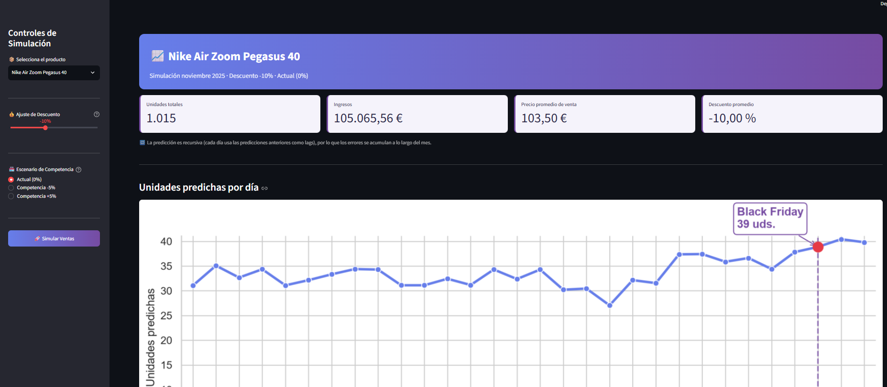
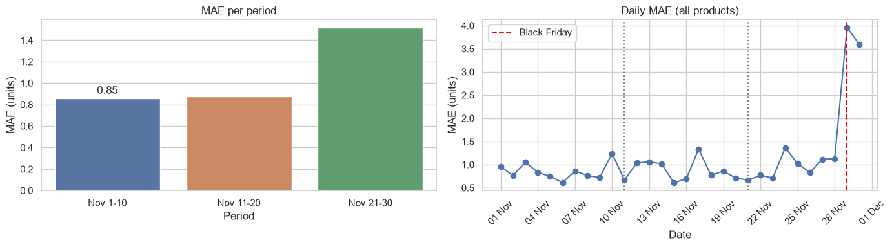
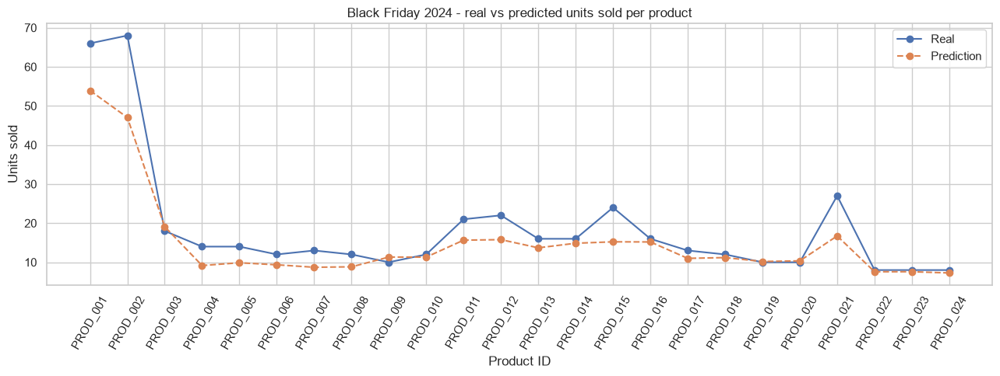
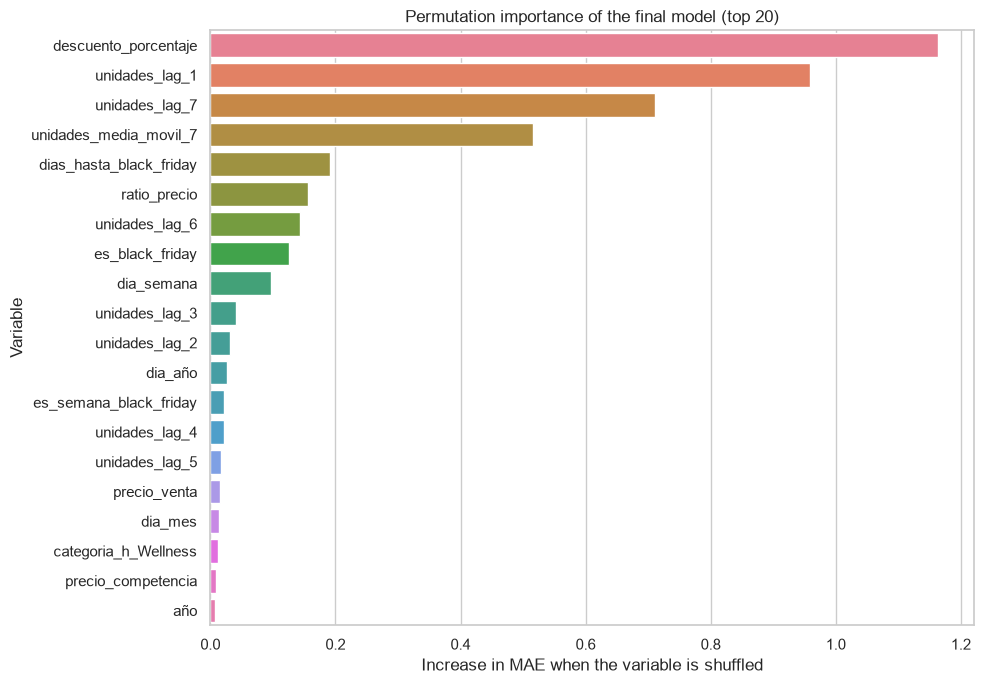

# Black Friday Sales Forecasting — Sports Retail

End-to-end demand forecasting project: from raw sales data to a recursive November 2025 forecast, a tuned scikit-learn pipeline, and an interactive pricing simulator built with Streamlit.



## Business problem

A sports retailer needs to know how many units of each product it will sell during November, and especially on Black Friday, to plan stock and pricing. This project forecasts daily unit sales per product for November 2025 and lets a user explore "what if" discount and competitor-price scenarios.

## Results

Validated on a full held-out year (2024), training on 2021–2023. Two evaluations are reported because they answer different questions:

- **One-step:** each day is predicted using the *real* sales of the previous days (lags). Optimistic.
- **Recursive:** only the last days of October are known, and every later day uses the model's own earlier predictions. This is the real situation for 2025.

| 2024 validation | MAE one-step | R² one-step | MAE recursive | WMAPE recursive | R² recursive |
|---|---|---|---|---|---|
| Naive baseline (train mean) | 3.67 | – | – | – | – |
| Conservative model | 1.082 | 0.870 | 1.419 | 26.8 % | 0.783 |
| **Tuned model (adopted)** | **0.969** | **0.929** | **1.198** | **22.6 %** | **0.855** |

The tuned model uses a randomised `max_features`, so its result depends on the seed: across seeds 0–4 the recursive WMAPE ranges from 19.9 % to 25.2 % (mean 22.6 %). Even its worst seed beats the conservative model.

**November 2025 forecast (24 products):** 3,711 units, in line with the real totals of previous years (2022: 3,805 · 2023: 4,217 · 2024: 3,814).

On Black Friday 2024 the peak is still underestimated (real: 450 units across the 24 products; tuned recursive forecast: 362).

| Error by period (conservative model, one-step) | Black Friday 2024: real vs predicted (conservative model) |
|---|---|
|  |  |

## Approach

- **Data:** 24 products × 37 days (25 Oct – 30 Nov) × 4 years (2021–2024) = 3,552 rows; 2,880 remain after building lag features. Target: `unidades_vendidas`. The datasets are synthetic.
- **Features (74 predictors):** calendar features (including days to Black Friday), lags 1–7 and a 7-day moving average of sales per product and year, price variables (own price, competitor price, price ratio, discount) and one-hot encoded categories. Revenue (`ingresos`) is excluded because it is a direct function of the target.
- **Pipeline:** a scikit-learn `Pipeline` (`ColumnTransformer` with `OneHotEncoder` + `HistGradientBoostingRegressor`) replaces the manual one-hot encoding. Preprocessing and model are one saved object, so training and inference cannot drift apart.
- **Validation by year:** train on 2021–2023, validate on 2024. A random split would mix days of the same campaign across train and validation and give optimistic results.
- **Hyperparameter tuning:** Optuna (TPE, 60 trials) with an expanding-window validation (train 2021 → validate 2022; train 2021–22 → validate 2023). The objective is the **recursive** WMAPE, not the one-step error, so the search optimises what will be used in production.
- **Recursive forecasting** (`src/forecasting.py`): day 1 uses the real lags from October; afterwards `lag_1` is the previous prediction, `lag_k` shifts down, and the moving average is recomputed from the updated lags. All 24 products are predicted together, day by day.
- **Simulator** (`src/simulation.py`, `app/streamlit_app.py`): starts from the retailer's real 2025 price plan and lets the user override the discount in a window (Black Friday, Black Friday week, or the whole month) and scale competitor prices.

## Decisions and findings

- **Lag leakage avoided.** Lags are computed per product *and* year, and the moving average uses `shift(1)` before the rolling window, so it never includes the current day's sales.
- **Validation metrics must match the use case.** One-step metrics hide the cost of using predicted lags: recursion raised the conservative model's MAE by 31 % (1.08 → 1.42). Tuning was therefore done on the recursive error.
- **A decision rule I had to revise.** Before tuning, I fixed two adoption criteria for the tuned model: (1) recursive WMAPE improves by ≥ 1 pp, and (2) the train/validation gap does not grow. The tuned model improved WMAPE by 4.2 pp but failed (2) — it fits the training data much better *and* validates better, so the gap criterion was badly specified. Rather than silently dropping it, I defined a new criterion **before** running the check (the worst of 5 seeds of the tuned model must beat the best of 5 seeds of the conservative one), recorded the change in `config/best_params.json` and the notebook, and adopted the model only after it passed.
- **Discount is confounded with Black Friday.** In the training data, discounts below −3 % occur almost only on days 17 and 24–30 of November. The model cannot separate the effect of a discount from the effect of the event.
- **Recursion does not amplify the discount effect** (tested): the ratio between the recursive and one-step effect of a −10 % discount is 0.96–1.15 for both models. The very large simulator responses to a month-long discount come from the model's reaction to the discount itself, already in the one-step prediction.
- **Coherence checks** (`notebooks/forecast_sanity_checks.ipynb`): the 2025 totals were compared with previous years, and a counterfactual applying the 2024 discount plan to 2025 brought the tuned model back to within +2 % to +6 % of the real 2024 total.



## Limitations

- **The simulator does not measure real price elasticity.** It shows how the model responds to a price plan. Both models agree on the direction of most scenarios but differ in magnitude, and sometimes in sign (for example, a −10 % discount over Black Friday week). A month-long discount is outside anything the model saw in training and is flagged as such in the app.
- **Competitor-price response is asymmetric for at least one product.** For Pegasus 40, a +5 % competitor-price scenario yields ~515 predicted units versus ~400 for a −5 % scenario — a wider swing than a modest price change would intuitively justify. This is most likely a model artifact driven by sparse competitor-price variation in the training data (the same underlying issue as the discount/Black Friday confound above), not a real causal price elasticity. Treat competitor-price outputs from the simulator as directional, not quantitative.
- **One validation year.** 2024 was also used to choose the original conservative hyperparameters, and again for the seed check. The tuned model's search itself used only 2021–2023.
- **Seed variance.** The tuned model's recursive WMAPE varies by about ±2.5 pp across seeds.
- **Peaks are underestimated.** Black Friday volumes are lower than real values for star products, even in the one-step evaluation.
- **Small, synthetic data:** four seasons and 24 products.

## How to run

Developed and tested with Python 3.13.9.

```bash
conda create -n forecasting python=3.13
conda activate forecasting
pip install -r requirements.txt
```

> `requirements.txt` is the portable installation (only the libraries the code imports, with pinned versions). `requirements-lock.txt` is the exact environment used on Windows (full `pip freeze`, including Windows-specific packages). Models saved with `joblib` depend on the scikit-learn version: use the same version to train and to run the app.

The synthetic datasets are included in `data/raw/`. Processed data (`data/processed/`) and trained models (`models/`) are git-ignored and generated by the notebooks, which must be run in this order:

1. `notebooks/entrenamiento.ipynb` — EDA, feature engineering, first model and the pre-one-hot dataset.
2. `notebooks/forecasting.ipynb` — prepares the 2025 inference data.
3. `notebooks/modelado_pipeline.ipynb` — scikit-learn pipeline and recursive evaluation on 2024.
4. `notebooks/tuning.ipynb` — Optuna search and the tuned pipeline (about 3 minutes).
5. `notebooks/forecast_sanity_checks.ipynb` — optional coherence checks of the 2025 forecast.

Then run the tests and launch the app from the project root:

```bash
python -m pytest
python -m streamlit run app/streamlit_app.py
```

## Project structure

```
app/              Streamlit simulator
src/              forecasting.py (recursive forecast), simulation.py (price plan)
tests/            Tests for the recursion and the price-plan logic
notebooks/        Training, inference preparation, pipeline, tuning, sanity checks
config/           best_params.json (tuned hyperparameters and adoption note)
docs/images/      Figures used in this README
data/raw/         Synthetic datasets (training and 2025 inference CSVs)
data/processed/   Generated by the notebooks (git-ignored)
models/           Trained models, generated by the notebooks (git-ignored)
```

## Next steps

- Compare with a no-lag model, which avoids error accumulation (the October lags would no longer matter).
- Average several seeds (for example with a `VotingRegressor`) to reduce the tuned model's variance.
- Publish the app online.
- Add a second held-out year when more data is available, to confirm the tuning result.

## Context

Built during the free 3-day *Data Science for Business* challenge, following its base scope (Black Friday forecasting) and then extending it on my own with a scikit-learn pipeline, hyperparameter tuning, a recursive validation scheme, leakage checks and an analysis of the simulator's limits.
